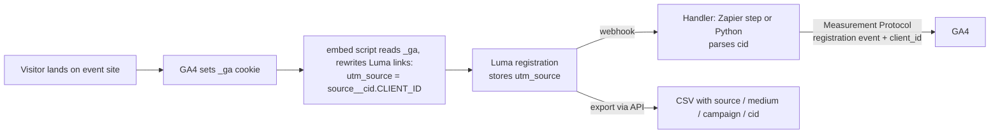

# event-registration-ga4-attribution

Carry a visitor's GA4 client ID through an event registration (Luma) and send the registration back to GA4, so it attaches to the visitor's earlier site history.

## The problem

Event platforms like Luma host registration on their own domain. The visitor leaves your site, GA4 loses the session, and the registration never shows up as a conversion tied to the ad, email, or post that brought them in. You end up with a registration list and no reliable way to say which channels produced it.

This repo fixes that by passing the GA4 client ID through the registration and replaying it to GA4 server-side.

## How it works



1. GA4 sets the `_ga` cookie, e.g. `GA1.1.1234567890.1700000000`. The client ID is the last two parts: `1234567890.1700000000`.
2. `embed/ga-cid-to-luma.js` rewrites Luma links, embeds, and checkout buttons on the page so `utm_source` becomes `<original utm_source>__cid.<client_id>` (or `direct__cid.<client_id>` when there is no utm_source).
3. Luma stores that value on the registration and fires a webhook.
4. The handler parses out the client ID and sends a `registration` event to GA4 with the Measurement Protocol, using that client ID.

## Repo layout

```
embed/ga-cid-to-luma.js         browser script (no dependencies)
handler/zapier_code_step.js     paste into a "Code by Zapier" step
handler/webhook_handler.py      standalone receiver, stdlib only
scripts/pull_registrations.py   export registrations to CSV, decoding utm_source
scripts/verify_ga4_attribution.py   check events landed in GA4 (Data API)
tests/                          unit tests (Python and JS share one case file)
```

## Setup

### 1. Create a GA4 Measurement Protocol secret

GA4 Admin > Data streams > your web stream > Measurement Protocol API secrets > Create. Note the measurement ID (`G-...`) and the secret. The secret goes in your middleware's configuration, never in client-side code or this repo.

### 2. Add the embed script

Host `embed/ga-cid-to-luma.js` with your site and load it after your GA4 tag, on pages that link to or embed Luma:

```html
<script src="/js/ga-cid-to-luma.js" defer></script>
```

It does nothing if there is no `_ga` cookie (visitor declined analytics, tag blocked). It retries for about 10 seconds in case GA4 sets the cookie late, and watches for embeds added to the page later.

### 3. Point the Luma webhook at a handler

In Luma, add a webhook for new registrations. Pick one handler.

**Option A: Zapier.** Trigger on the Luma registration. Add a "Code by Zapier" (JavaScript) step, paste `handler/zapier_code_step.js`, and map the Input Data fields documented at the top of the file (`encoded` is the registration's `utm_source`). Set `debug` to `true` for the first test.

**Option B: self-hosted.**

```bash
export GA4_MEASUREMENT_ID=G-XXXXXXXXXX
export GA4_API_SECRET=...            # from your secret store
export WEBHOOK_TOKEN=some-long-random-string   # optional; require ?token=...

python3 handler/webhook_handler.py --serve --port 8080 --dry-run   # validate only
python3 handler/webhook_handler.py --serve --port 8080             # live
```

Point Luma at `https://your-host/?token=some-long-random-string`. The handler looks for a `utm_source` key anywhere in the JSON body. Check your platform's actual payload and adjust if it differs. Try the parser without any network call:

```bash
python3 handler/webhook_handler.py --parse "newsletter__cid.1234567890.1700000000"
```

### 4. Verify

1. Open your event page with `?utm_source=test&utm_medium=setup&utm_campaign=verify`, register through the embed, and confirm the registration's `utm_source` ends in `__cid.<digits>.<digits>`.
2. Run the handler in dry-run mode (or Zapier with `debug` true) and confirm GA4's `validationMessages` is empty.
3. Go live, register once more, and check GA4 Realtime for a `registration` event.
4. After 24 to 48 hours:

```bash
pip install google-analytics-data
export GOOGLE_APPLICATION_CREDENTIALS=/path/to/service-account.json
python3 scripts/verify_ga4_attribution.py 123456789 --days 14 --expected 120
```

`123456789` is your GA4 property ID. The service account needs Viewer access to it. `--expected` is the registration count from your export, to compare against the GA4 event count.

To export registrations with the decoded columns:

```bash
export LUMA_API_KEY=...
python3 scripts/pull_registrations.py <luma_event_api_id> --output out/
```

## Attribution model

| Question | Where to look | Why |
|---|---|---|
| What was the last touch before registering? | UTMs stored in Luma (`source`, `medium`, `campaign` columns from the export) | Set on the link the visitor clicked |
| How did this person first find us (discovery)? | GA4 User Acquisition dimensions (`firstUserSource`, `firstUserMedium`, `firstUserCampaignName`) on the `registration` event | The stitched client ID ties the event to the visitor's first GA4 visit |
| What was the full path? | GA4 Path Exploration, filtered to users with a `registration` event | Same stitching, across sessions |
| Session source of the registration event itself | Not available | See Gotchas |

## Gotchas

- **Parse the cid by its `cid.` prefix, wherever it sits.** Do not split on `__` and take a fixed position. `utm_content` and other values shift the position, and a wrong client ID makes GA4 create phantom users whose first touch is direct. `tests/parse_cases.json` covers cid first, middle, and last, plus malformed values.
- **If there is no cid, skip the GA4 send.** Do not invent one.
- **Measurement Protocol ignores `utm_source` and `utm_medium` parameter names.** Use the reserved names `source`, `medium`, `campaign`, `term`, `content`. Even then, MP events do not get session-level source: the registration event's session source stays `(not set)`. What works is the model above: last touch from the UTMs in Luma, first touch from GA4 User Acquisition dimensions via the stitched client ID, full path from Path Exploration.
- **Direct `lu.ma` links never touch your website, so they carry no cid.** In the original deployment that was roughly half of registrations, while the embed captured a cid in over 90% of the cases where it ran. The biggest improvement is to UTM-tag every Luma link you distribute (emails, social posts, partner pages), so those registrations at least have last-touch data.
- **Changing the middleware can silently drop the GA4 call.** If you move from Zapier to a native webhook, or the other way, nothing errors when the GA4 step disappears. Monitor that the GA4 `registration` event count tracks registrations (`verify_ga4_attribution.py --expected N` does this comparison).
- **Keep the Measurement Protocol `api_secret` out of client-side code and the repo.** Put it in the middleware's secrets or environment. In Zapier it lives in the step configuration, so limit who can edit the Zap.
- **The live Measurement Protocol endpoint returns 204 even for bad payloads.** Use the debug endpoint (`--dry-run`, or `debug` in the Zapier step) while setting up.
- **Do not send email or names to GA4.** The handlers send only the client ID and campaign fields.

## Limitations

- Only as good as the cookie: no `_ga` cookie (consent declined, ad blockers, a different browser or device at registration time) means no cid.
- Checkout buttons and embeds are rewritten by changing `href` / `src`. If your Luma widget builds its URL from other data at click time, the rewrite will not reach it. Test with a real registration.
- The Luma webhook payload and API field names here are based on what the original deployment used; confirm them against current Luma docs.
- GA4 standard reports lag 24 to 48 hours, and user-level attribution can differ from what you expect if the visitor's cookie was reset between the site visit and registration.
- There is no session stitching: the event is attached to the user, not to the browsing session, so it will not appear in the session-scoped source reports.
- Tested with unit tests only. The scripts that call external APIs (GA4, Luma) are not covered by automated tests.

## Tests

```bash
python3 -m unittest discover -s tests -v   # also runs tests/test_js.js if Node is installed
```

## License

MIT
